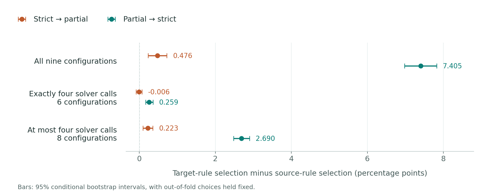

# Delivery Rules and Method Choice in LLM Collaboration under Hard Communication Budgets

**Chenyu Ma · Xuechen Chen · Feng Wang**  
Central South University · Xuechen Chen is the corresponding author

[Reproduce the statistics](statistics/README.md) · [Inspect the results](analysis_summary/summary.csv) · [Citation](CITATION.cff) · [License](LICENSE_SCOPE.md)

Which collaboration method should be selected when a communication budget can interrupt delivery? This study holds generated outputs fixed and compares **strict abort**, which exposes no answer after an incomplete exchange, with **partial commit**, which attempts to deliver the frozen resolution of the admitted prefix if its output fits. Both rules retain every task in the accuracy denominator.

The materials cover **700 tasks** (300 MATH and 400 MMLU-Pro), **9 configurations**, and **156 dependent synthetic budget contexts**. They support aggregate comparisons and statistical refitting without model calls or evaluator reference answers.

## Results at a glance



The difference is the held-out accuracy of the **target-rule-selected method minus the source-rule-selected method**, with both evaluated under the target rule. All values below are percentage points; brackets are 95% conditional bootstrap intervals.

| Candidate set (configurations) | Strict → partial | Partial → strict |
|---|---:|---:|
| All nine configurations (9) | 0.476 [0.232, 0.721] | 7.405 [6.980, 7.823] |
| Exactly four solver calls (6) | -0.006 [-0.082, 0.067] | 0.259 [0.167, 0.359] |
| At most four solver calls (8) | 0.223 [0.096, 0.355] | 2.690 [2.482, 2.898] |

Under strict evaluation, target-rule-selected accuracy is **58.008%** for exactly four calls, **65.442%** for at most four, and **66.236%** for all nine configurations. A smaller transfer difference does not imply higher absolute accuracy.

Same-data best-configuration sets differ in **49 of 156** contexts and agree in 107. The held-out context median is **zero in both directions** for all three candidate sets. Positive means therefore do not imply improvement in every setting; all negative and zero context results are retained in [context_results.csv](analysis_summary/context_results.csv).

A training-only completion filter gives the following residual partial-to-strict differences in the nine-configuration set. All three declared thresholds are reported.

| Minimum training completion | Residual, pp [95% conditional interval] | Empty-filter fallbacks |
|---|---:|---:|
| 90% | 0.090 [-0.012, 0.191] | 35/780 |
| 95% | 0.042 [-0.041, 0.128] | 46/780 |
| 99% | 0.417 [0.192, 0.651] | 206/780 |

Among eligible methods, selection still uses training partial accuracy. If none meet the threshold, maximum training completion is used, followed by partial accuracy and method-identifier tie breaking. This is an exploratory diagnostic, not a causal decomposition or a label-free selector. [All 20 refitted partitions](analysis_summary/split_sensitivity/summary.csv) describe sensitivity to task splits; their ranges are not population confidence intervals. The original prespecified rationale-sharing comparison remains inconclusive.

## Reproduce

Use Python 3.12. From the repository root, the aggregate audit needs only the standard library:

```sh
python3 -m unittest discover -s audit_report -v
python3 audit_report/delivery_contract_audit.py --contract audit_report/inputs/contract.json --scores audit_report/inputs/scores.csv --resources audit_report/inputs/resources.csv --out aggregate_reproduced
```

Expected: **9 tests**, **936 comparison rows**, **49** strict/partial best-set changes, and **67** changes when the separate profile-known preflight comparison is included. Aggregate coverage checks alone cannot establish unique task membership.

For task-level selection, intervals, and alternate partitions:

```sh
python3 -m pip install -r statistics/requirements.txt
python3 statistics/scripts/run_sanity_tests.py -v
python3 statistics/scripts/reproduce_selection.py --data-root statistics --out statistics/reproduced
python3 statistics/scripts/reproduce_intervals.py --data-root statistics --selection statistics/reproduced/oof_results.npz --out statistics/reproduced/conditional_intervals.json
python3 statistics/scripts/reproduce_selection.py --data-root statistics --out statistics/split_reproduced --all-splits
```

Use new output directories on each run. The eight boundary tests exercise selection and completion filtering. Scripts compute from the supplied arrays and folds; they do not read `statistics/expected/`. See the [statistical guide](statistics/README.md), [array schema](statistics/schema.json), and [analysis plan](statistics/analysis_plan.json).

## Repository map

| Path | Contents |
|---|---|
| [audit_report/](audit_report/) | Aggregate inputs, contract schema, comparison interface and tests |
| [statistics/](statistics/) | Anonymous task metrics, original and 20 alternate folds, statistical scripts |
| [analysis_summary/](analysis_summary/) | Contrasts, completion thresholds, grid strata and split sensitivity |
| [heldout_summary/](heldout_summary/) | Original held-out aggregate results |
| [historical_aggregates/](historical_aggregates/) | Earlier aggregate comparisons and resource summaries |
| [tools/](tools/) | Figure and table generation |
| [docs/](docs/) | Self-contained project website and downloadable analysis snapshot |

To regenerate the website figure:

```sh
python3 -m pip install -r requirements-plotting.txt
python3 tools/generate_web_figure.py --source-root . --out docs/assets
```

The existing story figures and original tables can be regenerated with `tools/generate_story_assets.py --source-root . --output-root regenerated_assets`; the added numerical tables use `tools/generate_final_tables.py --source-root . --out regenerated_tables` (prefix both commands with `python3`).

## Interpretation and data scope

- Failures remain in the full denominator. A/B groups are averaged within task; AO-SC8 contributes its one shared AB result. MATH and MMLU-Pro receive equal weight.
- The 10,000-replicate task-cluster bootstrap holds out-of-fold choices fixed, with no selector refitting or multiplicity adjustment. The 156 contexts are dependent settings, not a sampled deployment distribution.
- The release reproduces selection and interval estimates from frozen derived metrics. It does not independently validate original gold grading, regenerate model outputs, or reconstruct raw-message admission.
- Question text, raw generated answers, evaluator references, original task identifiers, private reviews and correspondence are excluded. The manuscript and supplementary PDF are not included in this data/code release.

## Project website

The repository README renders directly on GitHub. To publish the accompanying static website, open **Settings → Pages**, choose **Deploy from a branch**, select **main** (or the uploaded branch) and **/docs**, then save. GitHub displays the site URL once deployment succeeds. Later commits to the publishing branch trigger updates. No account name or repository URL needs to be edited in the website files.

For an offline preview, open `docs/index.html`. Site styles, figures, and downloads are all local; no package manager, API key, or remote font is needed. The website download is the unchanged **2026.10.12 scientific snapshot**; the repository also contains the presentation files.

## Citation and licenses

Please use [CITATION.cff](CITATION.cff) to cite these reproducibility materials. Data and analysis snapshot: **2026.10.12**; presentation text updated **2026.10.19**. The website download retains the original scientific snapshot. No publication DOI is asserted.

Original code is licensed under [MIT](LICENSE_CODE_MIT.txt); derived data, documentation and figures are [CC BY 4.0](https://creativecommons.org/licenses/by/4.0/). See [LICENSE_SCOPE.md](LICENSE_SCOPE.md) for the exact scope. File checksums are in [MANIFEST_SHA256.txt](MANIFEST_SHA256.txt).
